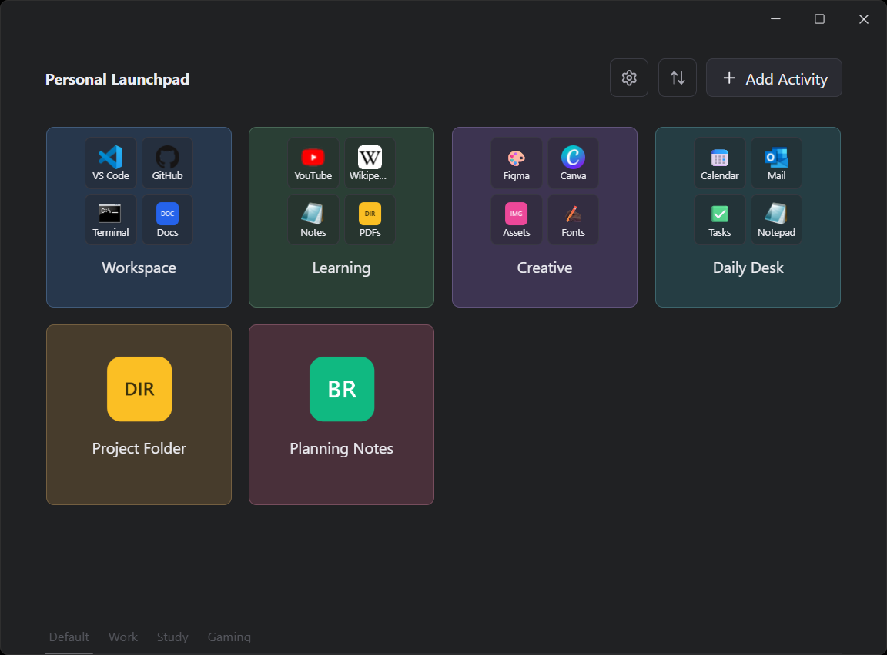
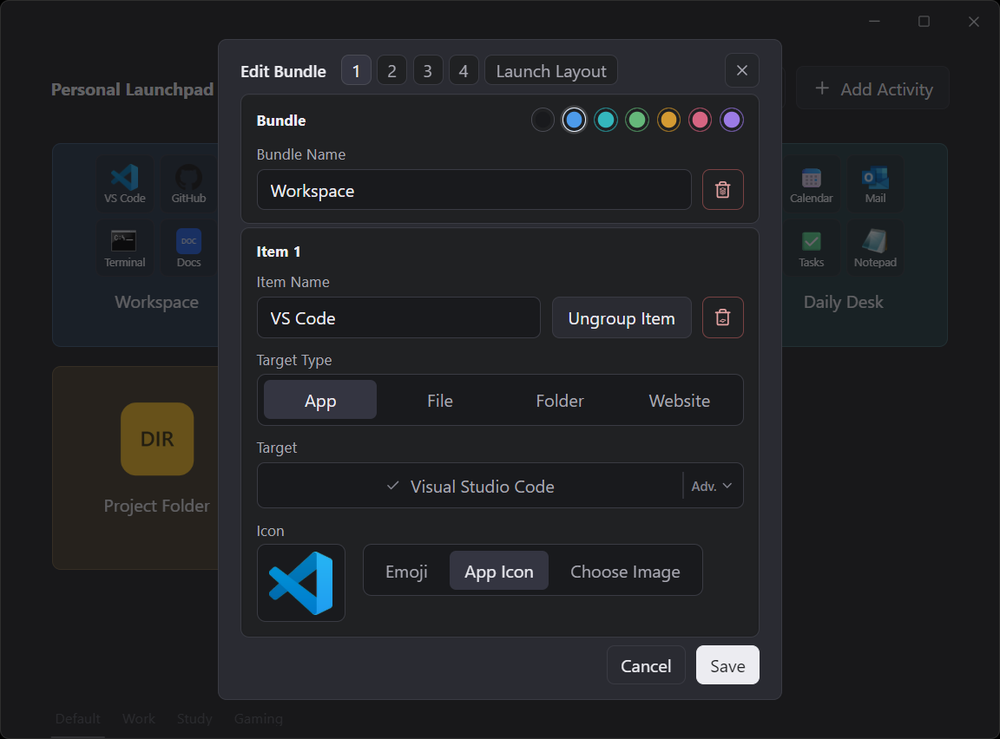
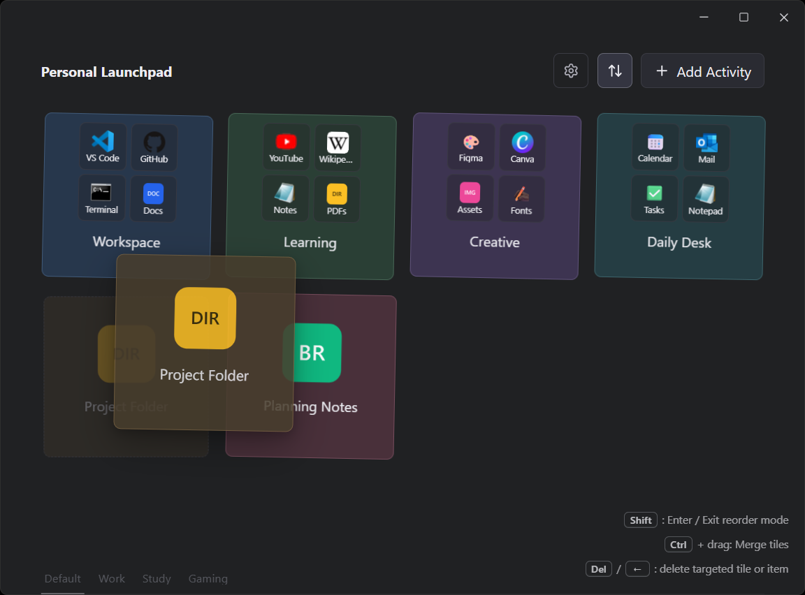
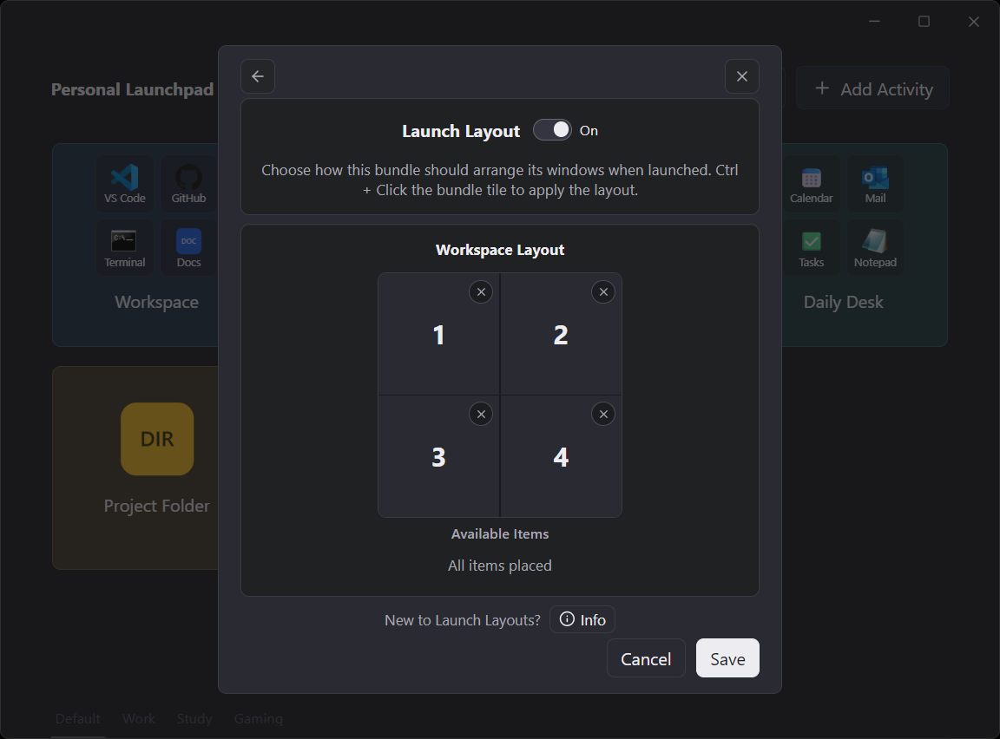
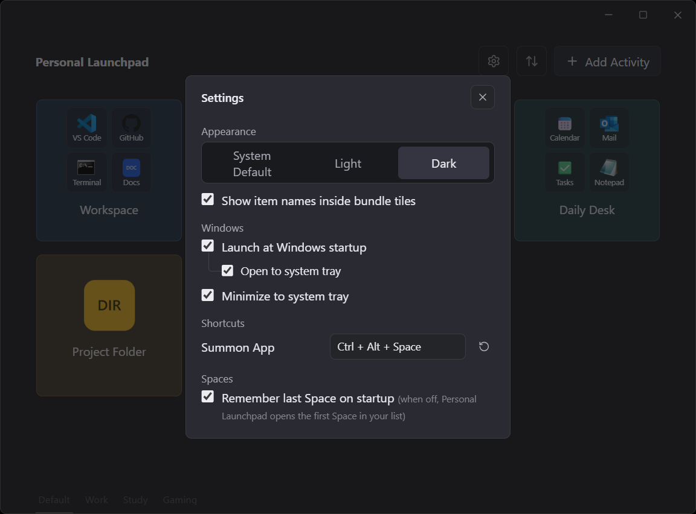

# Personal Launchpad

Every day, you open the same apps, folders, files, and websites. Personal Launchpad lets you turn those repeated setups into clean activity tiles and one-click workflows.

Personal Launchpad is a calm, local-first Windows desktop launcher for intentional activities. Your activities, settings, and cached icons stay on your Windows profile under `%APPDATA%/PersonalLaunchpad/`.

## What You Can Launch

An activity can open an app, installed Windows app, file, folder, or website. A bundle can launch several related items together, so a recurring setup becomes a single click instead of a small pile of repeated clicks.

## Examples

- Study: notes, a research folder, browser resources, and reference sites.
- Development: editor, project folder, docs, terminal, and GitHub.
- Gaming: launcher, chat, clips folder, and companion websites.
- Daily: calendar, notes, task list, mail, and browser resources.

## Features

### Activities

Create focused tiles for the things you intentionally launch. Activities support rich icons, website favicons, extracted app icons, selected image icons, and curated colors for visual grouping.

Quick Drop lets you drag files, folders, executable apps, and `.url` internet shortcuts onto empty launchpad space to create activities quickly. Paths pasted from Windows "Copy as path" are normalized automatically when the whole target is wrapped in quotes.

### Bundles

Bundles group related activities so you can launch individual items or the whole workflow. Create bundles from the activity form, or turn on Reorder Mode and `Ctrl`-drag one tile onto another to merge them.

Bundle colors stay independent from child item colors. If a colored item is ungrouped later, its item color is preserved.

### Spaces

Organize your activities into contexts such as Work, Study, Gaming, or Daily. Use the bottom Spaces strip to switch contexts, and right-click a Space label to create, rename, or delete Spaces. Activities scroll within their own area, showing up to two complete rows above the Spaces strip.

### Reorder Mode

Reorder Mode is for shaping the launchpad: move tiles, merge tiles into bundles, delete targeted tiles or bundle items, move tiles across Spaces, and move bundle child items out as standalone activities.

### Launch Layouts

Launch Layouts arrange windows for whole-bundle launches on Windows. Place bundle items into a visual workspace, enable the layout, and Personal Launchpad will best-effort open and position those windows when the whole bundle launches.

Launch Layouts work best when the target windows are not already open.

### Hotkey and Startup

Summon Personal Launchpad from anywhere with the Global Hotkey, defaulting to `Ctrl+Alt+Space`. The shortcut is editable from Settings.

Personal Launchpad supports Windows startup launch, Minimize to system tray, Open to system tray on startup, and single-instance behavior so opening it again focuses the existing window.

### Updates

Launchpad checks quietly after startup and daily while running. Settings shows whether you are up to date or a new version is available. Nothing downloads or installs without your choice. Downloaded updates stay ready for the current session; choosing Later returns to the ready screen.

## Download

Download the current Windows installer from the [GitHub Releases](https://github.com/MartinMans/personal-launchpad/releases) page.

The current release is `v1.0.5`, distributed as a single Windows x64 NSIS EXE. Install v1.0.3 manually when upgrading from v1.0.2; later releases are offered in Settings. When a newer version is available, choose View update to read its release notes and download it. You can keep using Launchpad during the download, then return to install and restart. See the [release notes](CHANGELOG.md#103) for backup-first MSI transition instructions. Installer files are attached to GitHub Releases and are not committed to this repository.

## Release Notes

See [CHANGELOG.md](CHANGELOG.md) for release history.

## License

Personal Launchpad is proprietary software.

This public repository provides product information, screenshots, release notes, and links to installer downloads. It does not grant permission to copy, modify, redistribute, reverse engineer, or reuse the application or its assets except as expressly allowed in [LICENSE.md](LICENSE.md).

